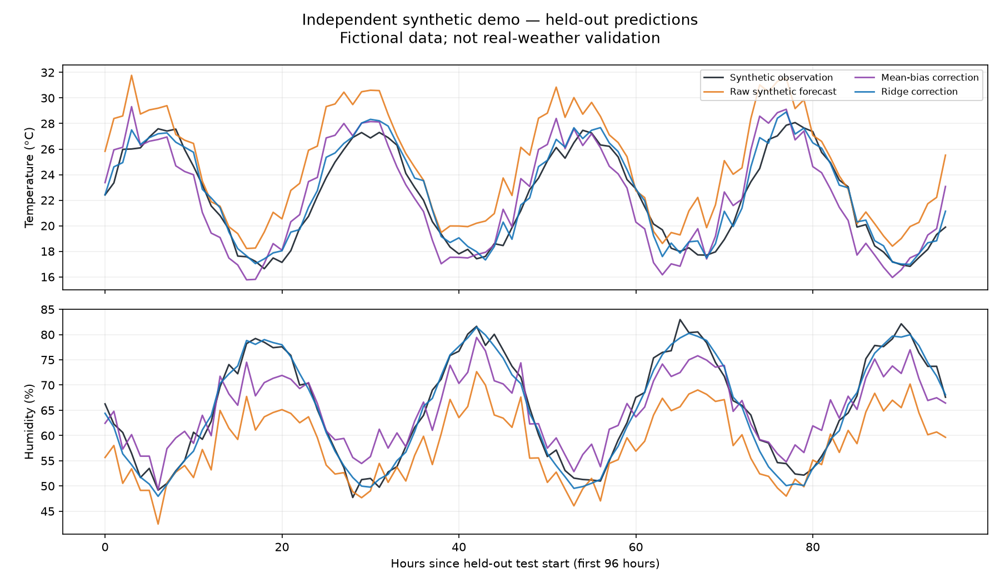
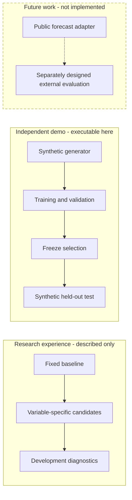

# Hybrid Weather Forecasting — Engineering Portfolio

**Problem:** numerical weather forecasts can have local temperature and humidity bias. **Approach:** retain the numerical forecast and learn a small correction rather than predict weather from scratch.

**My contribution:** I designed baseline-versus-candidate experiments, implemented variable-specific correction and composition workflows, and evaluated errors through matched observations and overlapping plots. This portfolio now includes a separately written, runnable synthetic example of that engineering approach.

**Limits:** the results below use fictional data with deliberately learnable bias. They demonstrate implementation and evaluation, not real-weather skill. Company-owned code, weights, measurements, configurations, and internal artifacts are not included.

## What is completed—and what is not

| Work | Status and evidence |
| --- | --- |
| Research engineering experience | Completed in a company setting; described in the [case study](docs/CASE_STUDY.md). Original artifacts and quantitative findings are not published |
| Independent synthetic implementation | **Runnable here:** generator, statistical baseline, ridge learner, model selection, held-out evaluation, tests, and regenerated plots |
| Held-out validation of the synthetic demo | **Completed:** 408 test cases per target, separate from fitting and model selection |
| Public forecast adapter and real-world evaluation | **Future work:** not implemented; no real-weather accuracy claim |

## My engineering decisions

- **Designed:** preserve a fixed baseline and compare candidates on identical cases; improve humidity and rainfall separately without silently changing temperature behavior.
- **Implemented:** observation-reference handling, candidate prediction and composition workflows, and diagnostic plots in the research context. For this independent demo, implemented a small ridge correction learner and reproducible evaluation using the Python standard library.
- **Evaluated:** target-specific errors, forecast timing, missed rain, sensor-reference choices, and limitations of inspected development observations. The new demo has its own separate synthetic test set.
- **Learned:** data availability and sensor semantics can matter as much as the learner; development diagnostics must not be presented as blind validation.

## Run and independently verify

From the repository root with Python 3.12 or newer:

```sh
# Standard library only: retrain and check the posted models, metrics, and predictions.
python examples/run_demo.py --verify
python -m unittest discover -s tests -v

# Regenerate numerical results without plotting dependencies.
python examples/run_demo.py --no-plots

# Regenerate the graphs as well.
python -m pip install -r requirements.txt
python examples/run_demo.py
```

No API keys, company data, or network requests are needed to run the demo. Installing plotting dependencies requires package access. Numerical verification allows a tolerance of 1e-10; image pixels may vary across rendering environments.

## Independently generated results

Fixed seed **83021**; **2,160 synthetic hourly records**. Chronological splits contain 1,296 training, 408 validation, and 408 test cases, with 24 excluded hours before validation and test. Model fitting uses training only; regularization is selected by validation MAE; test labels are used only after selection.

| Test MAE—lower is better | Raw synthetic forecast | Mean-bias correction | Ridge correction |
| --- | ---: | ---: | ---: |
| Temperature (°C) | 2.454 | 1.286 | **0.608** |
| Humidity (percentage points) | 7.356 | 4.236 | **1.521** |

These are synthetic-example errors, not company results or an overall accuracy percentage. The generator intentionally creates a correction-friendly relationship; the improvement does not establish transfer to real forecasts or stations.



Inspect the [all-test error chart](results/test_errors.png), [full metrics](results/metrics.json), [408 paired predictions](results/predictions.csv), [newly trained model parameters](results/models.json), and [artifact checksums](results/checksums.json).

## Architecture and scope

The two work streams below are separate. There is no claim that the historical research diagnostics constitute held-out real-world validation.



The [methodology](docs/METHODOLOGY.md) explains feature engineering, statistical correction, model fitting, leakage safeguards, metric definitions, and the remaining evaluation limits. The [case study](docs/CASE_STUDY.md) provides the longer account of my contributions and lessons.

This example covers temperature and humidity only. Rainfall, observation ingestion, pressure, lux, UV inputs, and production deployment are outside its implemented scope. Company-owned intellectual property remains with its owner; no company assets are transferred into this demonstration. No license file is included.
