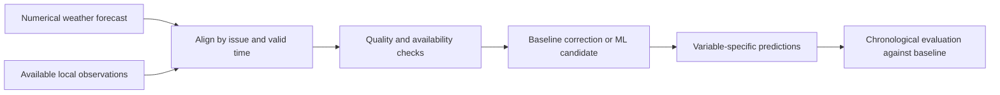
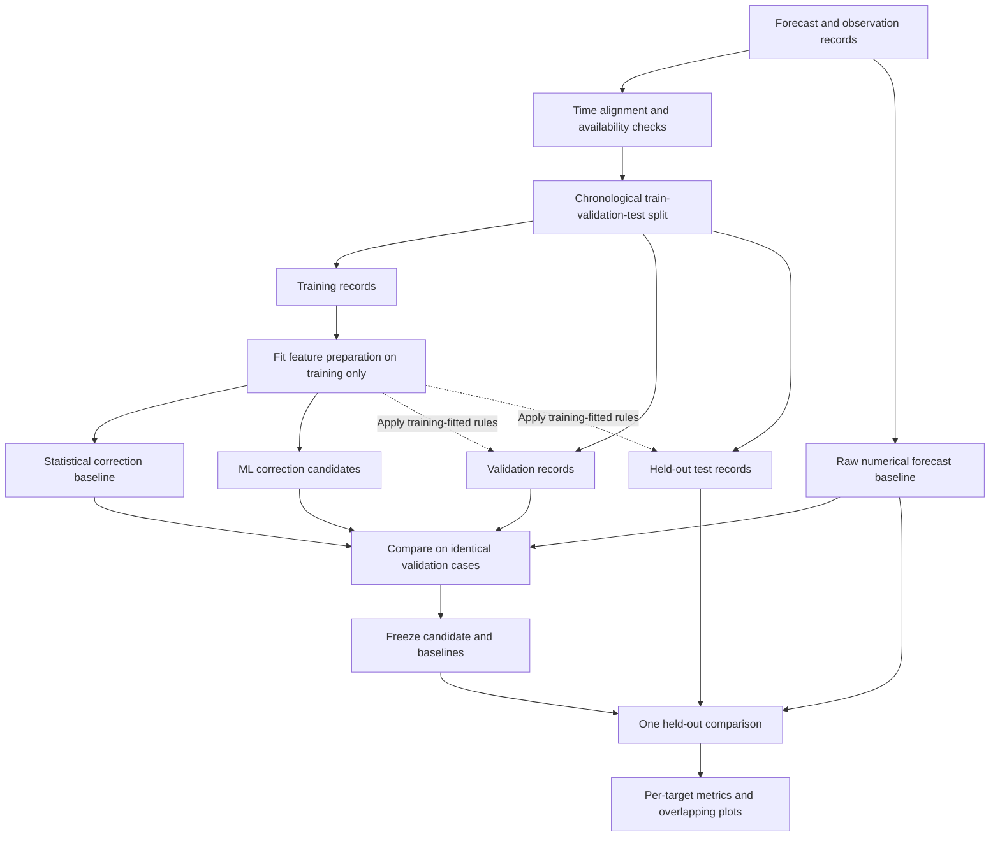

# Hybrid Weather Forecasting — Engineering Case Study

## Project Scope and Limitations

This repository is a limited, portfolio-oriented demonstration of hybrid weather forecasting techniques using numerical weather predictions and local sensor observations.

The purpose is to demonstrate the engineering methodology, system architecture, model evaluation, and technical challenges involved in weather forecast bias correction.

The forecasting methods and examples are intended for technical demonstration and educational purposes.

This is a documentation-only case study. It contains no forecasting implementation, trained model weights, measured datasets, station configuration, or internal research artifacts. It does not provide a runnable forecast service or a reproduction of a company system.

## Problem

A numerical weather prediction forecast describes atmospheric conditions over a grid. A sensor measures conditions at a particular location. Differences in spatial resolution, terrain, observation quality, and timing can produce persistent differences between the two.

The engineering question is whether a correction learned from past forecast–observation pairs can improve local forecasts over a numerical baseline. A more complex learner is useful only when a fair evaluation demonstrates that improvement.

Temperature, humidity, and rainfall require separate evaluation. A candidate can improve one variable while worsening another.

## Hybrid approach

The approach starts with an existing numerical weather forecast and learns corrections or local relationships using observations available at forecast issue time. It does not attempt to learn atmospheric physics or generate weather entirely from scratch.



This diagram describes a general engineering pattern. It does not disclose deployment topology, sensor locations, proprietary parameters, or private integrations.

| Stage | Engineering responsibility |
| --- | --- |
| Forecast preparation | Preserve forecast issue time, valid time, and lead time |
| Observation preparation | Check units, missingness, sensor validity, and time alignment |
| Feature preparation | Use only information available when a prediction would be issued |
| Baseline | Establish raw numerical forecasts and a simple correction reference |
| Candidate modeling | Compare statistical corrections, tree-based learners, or ensembles |
| Evaluation | Score each variable, horizon, and supported location separately |
| Release decision | Prefer a candidate only where improvement and coverage are supported |

## My engineering contribution

My contribution was to organize the forecasting work as a sequence of testable engineering decisions: establish a baseline, isolate a candidate change, inspect its behavior, and decide where the evidence supports using it.

### What I designed

- **A baseline-and-candidate workflow.** I kept a reference forecast fixed while investigating separate model candidates, so changing the model would not silently change the comparison.
- **Separate treatment of forecast variables.** I scoped humidity and rainfall improvements separately and retained the temperature baseline while investigating those changes.
- **A composition strategy.** I combined selected variable-specific approaches into a common forecast output while keeping unsupported cases on a baseline or fallback path.
- **An observation comparison strategy.** I used nearby sensors as supplementary context and investigated soil wetting as a possible rainfall signal, with explicit attention to irrigation and fertigation ambiguity.

### What I implemented

- Forecast–observation comparison workflows with explicit sensor-reference choices, timestamp alignment, and missing-data handling.
- Candidate training and prediction workflows using tree-based learners and humidity ensemble combinations.
- Composition of humidity and rainfall candidates with the retained temperature baseline.
- Evaluation summaries and overlapping plots of observations, baseline forecasts, and candidate predictions.

These implementations belong to the original research context. They are described here as my engineering experience; their company-owned code, weights, data, and internal artifacts are not part of this repository.

### What I evaluated

I compared baseline and candidate behavior for temperature, humidity, and rainfall separately. I inspected both aggregate errors and overlapping time-series plots to understand systematic bias, forecast timing, and missed events.

For humidity, I investigated whether candidate models or an ensemble improved agreement with the selected observation reference. For rainfall, I examined event detection and amount prediction separately, including whether local and nearby sensor context could help explain wetting patterns.

I also examined the limits of the evidence: observations already inspected during development, assumed observation delays, site-specific coverage, and inconsistent rainfall improvements. I did not treat an inspected diagnostic period as new blind validation or assume that a better score for one target established improvement for every target.

### What I learned

The most useful outcome was a clearer understanding of where apparent model gains can be misleading: reference-sensor choices affect the target, missing arrival timestamps leave availability uncertain, and dry-heavy rainfall accuracy can conceal missed rain. These findings shaped the evaluation and reporting decisions described below.

No company-derived scores or unpublished quantitative findings are disclosed in this account.

## Feature, model, and evaluation architecture

I separated feature preparation, model candidates, and evaluation so that a modeling change could be examined without redefining the target or silently changing the evaluation cases.

The following original diagram expresses that design reasoning at a conceptual level. It is not a deployment diagram or a claim that a complete independent implementation is available in this repository.



| Design choice | Reason |
| --- | --- |
| Availability checks before feature preparation | Prevent later sensor readings from entering an earlier prediction |
| Forecast value, lead time, local time, and available observation history as feature families | Separate forecast context from local recent conditions without prescribing proprietary feature definitions |
| Training-only fitting of feature rules and model parameters | Keep validation and test information out of fitting |
| Statistical correction beside ML candidates | Make added complexity justify itself against a simpler correction |
| A validation stage before freezing | Separate candidate selection from final held-out assessment |
| Identical evaluation cases and explicit fallback coverage | Avoid attributing a change in coverage to a better model |
| Per-target plots and metrics | Expose timing errors and variable-specific tradeoffs hidden by a single score |

This is the reference architecture I would use for the independent portfolio example. The stronger held-out protocol shown here is an evaluation objective; it does not retroactively turn earlier development diagnostics into blind tests.

## Validation methodology

The following protocol explains how to assess this class of system. It is not a claim that every test below has been completed or can be reproduced from this documentation.

1. **Define the prediction contract.** Specify the target, units, forecast issue time, valid time, lead time, and observation reference.
2. **Establish observation quality.** Resolve sensor semantics, missing values, invalid readings, and rainfall accumulation intervals before scoring.
3. **Audit availability.** Distinguish measurement time from arrival time. A measurement timestamp alone does not prove that the reading was available to a live prediction.
4. **Split chronologically.** Keep training before validation, reserve a final unseen period, and freeze the candidate before examining that period. Random row splits can leak temporal information.
5. **Compare identical cases.** Score the numerical baseline, simple correction, and candidate on the same valid observations and horizons. Report excluded cases and fallback coverage.
6. **Evaluate each target separately.** Use continuous-error metrics for temperature and humidity and both occurrence and amount metrics for rainfall.
7. **Inspect patterns.** Overlay observations and forecasts; examine error by horizon, time of day, and weather regime. Fit all preprocessing using training data only.
8. **Report uncertainty and selection effects.** Account for correlated observations, overlapping rain windows, limited wet events, and repeated candidate selection. Retest on genuinely unseen conditions before making deployment claims.

### Metric definitions

| Target | Useful measures | Interpretation |
| --- | --- | --- |
| Temperature | MAE, RMSE, signed bias, within-tolerance rate | State temperature units and tolerance explicitly |
| Relative humidity | MAE, RMSE, signed bias, within-tolerance rate | Absolute errors are humidity percentage points |
| Rain occurrence | Precision, recall, balanced accuracy, Brier score | State event and decision thresholds; compare with an all-dry baseline |
| Rain amount | MAE, RMSE, accumulation bias | Match observation and prediction accumulation windows |

A tolerance rate is the fraction of evaluated cases whose absolute error is within a stated tolerance. Relative error reduction compares a candidate's error with a baseline's error. These quantities are different and must not be presented as a single overall accuracy percentage.

No company-derived scores, fitted parameters, measured examples, or original comparison graphs are published here. This case study makes no quantitative performance claim about a deployed system.

## Technical challenges and limitations

- **Reduced feature scope.** This demonstration does not cover air pressure, light intensity in lux, or UV index. Their possible value would need to be established by a controlled feature-ablation study.
- **Local applicability.** A correction that helps one location may not transfer to another climate, sensor installation, or season.
- **Sensor reference quality.** Agreement with an observation does not prove that the reference sensor is calibrated.
- **Observation delay.** Training with readings unavailable at prediction time can overstate real-world performance.
- **Rainfall imbalance.** Dry periods can dominate ordinary accuracy even when a model misses most rain.
- **Ambiguous soil signals.** Soil wetting can follow rain, irrigation, or fertigation. It cannot independently establish rainfall amount or cause.
- **Nearby-site differences.** Nearby sensors can provide context, but localized storms and different installations prevent automatic substitution of missing measurements.
- **Window consistency.** Independently modeled rainfall windows may overlap or disagree. Their totals and probabilities cannot simply be added.
- **Model complexity.** Ensembles and additional predictors do not guarantee improvement. Compare against a simple baseline and check for overfitting.
- **Evidence limits.** Without released evaluation data and implementation, readers cannot independently reproduce quantitative outcomes from this repository.

## Lessons learned

1. **I learned to preserve the comparison before tuning the model.** A fixed baseline, target definition, and shared observation set make a candidate's behavior easier to interpret.
2. **I learned that sensor semantics are part of the model specification.** Choosing a humidity reference or combining temperature readings changes what is being predicted and scored.
3. **I learned to distinguish timestamps from availability.** Measurement times do not resolve when an operational prediction could actually access a reading.
4. **I learned that rain needs more than a headline accuracy score.** Dry-dominated accuracy and ambiguous soil wetting can both give a misleading impression of useful rain detection.
5. **I learned to qualify evidence.** Development plots and inspected diagnostics are useful for investigation, but an unseen evaluation is still needed for stronger performance claims.
6. **I learned to separate engineering experience from publishable assets.** A portfolio can explain my decisions and limitations without reproducing company-owned materials.

## Planned independent reproducible example

**Status: planned; no executable example, training pipeline, or model artifact is included yet.**

The next step is a small implementation written independently for this portfolio, using fictional station observations and a documented public weather forecast snapshot. It will not reuse company source files, weights, measurements, station settings, or internal research artifacts.

The synthetic observations will be generated with controlled bias and noise for a repeatable learning exercise. They will not be represented as real station measurements. Public forecasts used alongside synthetic outcomes will not make the resulting evaluation a real-world accuracy benchmark.

### Intended structure

The paths below are a proposed layout, not files currently available in this repository.

```text
src/
  synthetic_data.py       fictional observations with a fixed random seed
  forecast_input.py       documented public forecast snapshot input
  features.py             availability-aware feature preparation
  baseline.py             simple statistical bias correction
  train.py                independent correction-model training
  predict.py              frozen-model prediction
  evaluate.py             matched baseline and candidate scoring
examples/
  run_demo.py             one entry point for the complete experiment
tests/
  test_pipeline.py        meaningful alignment and leakage checks
results/
  comparison.png          regenerated synthetic-example plot
```

### Completion criteria

- [ ] Write the implementation independently and document the public forecast source, attribution, issue times, and snapshot retrieval.
- [ ] Generate clearly labeled synthetic observations with a fixed seed and documented assumptions.
- [ ] Preserve an offline replay option using a permitted, fixed forecast snapshot rather than relying on a changing live response.
- [ ] Compare the raw forecast, simple statistical correction, and one small learned candidate on chronological splits.
- [ ] Provide one documented command to regenerate metrics and overlapping plots in a pinned environment.
- [ ] Check that future observations cannot enter earlier features and that every candidate is scored on the same cases.
- [ ] Label all generated results as synthetic demonstration evidence and repeat the content review before publication.

## Ownership and portfolio boundary

This case study is informed by research undertaken in a company setting. Company-owned intellectual property remains with its owner. The repository presents a general methodological account and does not reproduce or grant rights to company-owned code, models, measurements, configurations, or internal research material.

No software or model license is included.
