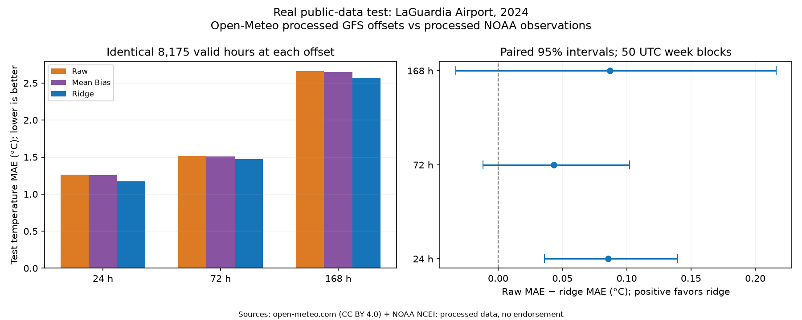
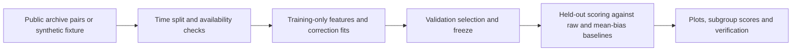

# Hybrid Weather Forecast Bias Correction

An independent engineering portfolio: learn local corrections to numerical weather forecasts, then check whether they improve on an unchanged baseline. Includes a runnable synthetic demo and a retrospective public-data temperature benchmark.

**My contribution:** I designed baseline/candidate comparisons, implemented correction and evaluation pipelines, and investigated how sensor references, timing and changing weather conditions affect results. [Engineering experience](docs/CASE_STUDY.md).

## Real public-data result

At a public NOAA airport station, **24-hour-offset temperature MAE decreased from 1.261°C to 1.176°C** on matched 2024 observations. This is one station, one year, and a processed forecast archive—not a prospective deployment or company-system result.



| Forecast offset | Processed GFS MAE | Mean-bias MAE | Ridge MAE | Paired MAE improvement, 95% interval |
| --- | ---: | ---: | ---: | ---: |
| 24 h | 1.261°C | 1.255°C | 1.176°C | +0.086°C [0.036, 0.140] |
| 72 h | 1.518°C | 1.509°C | 1.474°C | +0.043°C [−0.012, 0.102] |
| 168 h | 2.660°C | 2.652°C | 2.574°C | +0.087°C [−0.033, 0.216] |

All offsets use the same **8,175 accepted valid hours** (93.1% of the 2024 hourly grid), producing 24,525 forecast–observation pairs. Archive gaps mean the common test cohort starts **January 25**, not January 1; January and winter evidence are incomplete. Shared observations are not independent extra samples. Training/selection use 2023 only. Positive improvement favors ridge; intervals use paired calendar-week clusters. The longer-offset intervals include zero. Some monthly and seasonal slices worsen: [changing conditions](results/real_world/changing_conditions.png).

Inspect [full scores and subgroup intervals](results/real_world/metrics.json), [paired predictions](results/real_world/predictions.csv), [source provenance](data/public/provenance.json), and [protocol, coverage and limitations](docs/REAL_WORLD_EVALUATION.md).

## What is implemented

| Work | Evidence and boundary |
| --- | --- |
| Company-context engineering experience | Described only; no original company code, data or weights |
| Independent synthetic exercise | Temperature/humidity generation, training, held-out scoring and [plots](results/forecast_vs_observation.png); synthetic scores are not real-weather evidence |
| Public archived-forecast evaluation | Temperature only: NOAA LaGuardia observations, Open-Meteo processed GFS at three offsets; monthly, seasonal and quarterly breakdowns with uncertainty |
| CI workflow | Prepared for pushes/PRs, with tests and both numerical checks; hosted execution is pending publication |
| Live operation and external transfer | Not demonstrated; no humidity/rainfall real-data claim, multi-station claim or company-system comparison |

## Reproduce without API keys

From the repository root with Python 3.12 or newer:

```sh
python -m unittest discover -s tests -v
python examples/run_demo.py --verify
python examples/run_real_world.py --verify
```

These commands are offline, use the Python standard library, retrain independently, and compare scores and predictions against the frozen artifacts. To regenerate the plots:

```sh
python -m pip install -r requirements.txt
python examples/run_demo.py
python examples/run_real_world.py --plots
```

Data refresh is a separate, explicit network step. See [public source attribution](data/public/SOURCES.md) and the [real-data protocol](docs/REAL_WORLD_EVALUATION.md). Original archive timing, revisions, missingness and station/grid mismatch limit inference; no reanalysis is presented as a forecast or observation.

## Implemented independent architecture



This diagram covers the independent implementations, not historical company deployment. Detailed reading: [synthetic methodology](docs/METHODOLOGY.md), [real-data evaluation](docs/REAL_WORLD_EVALUATION.md), [contributions and lessons](docs/CASE_STUDY.md), [proposed GitHub description/topics](docs/GITHUB_METADATA.md).

Company-owned intellectual property remains with its owner. Public airport metadata are explicitly identified and unrelated to company sites. No company assets or project license file are included; public datasets retain their attribution terms.
