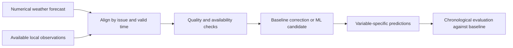

# Hybrid Weather Forecasting — Engineering Case Study

## Project Scope and Limitations

This repository is a limited, portfolio-oriented demonstration of hybrid weather forecasting techniques using numerical weather predictions and local sensor observations.

The purpose is to demonstrate the engineering methodology, system architecture, model evaluation, and technical challenges involved in weather forecast bias correction.

The forecasting methods and examples are intended for technical demonstration and educational purposes.

This is a documentation-only case study. It contains no forecasting implementation, trained model weights, measured datasets, station configuration, or internal research artifacts. It does not provide a runnable forecast service or a reproduction of a company system.

## Problem

A numerical weather prediction forecast describes atmospheric conditions over a grid. A sensor measures conditions at a particular location. Differences in spatial resolution, terrain, observation quality, and timing can produce persistent differences between the two.

The engineering question is whether a correction learned from past forecast–observation pairs can improve local forecasts over a numerical baseline. A more complex learner is useful only when a fair evaluation demonstrates that improvement.

Temperature, humidity, and rainfall require separate evaluation. A candidate can improve one variable while worsening another.

## Hybrid approach

The approach starts with an existing numerical weather forecast and learns corrections or local relationships using observations available at forecast issue time. It does not attempt to learn atmospheric physics or generate weather entirely from scratch.

This diagram describes a general engineering pattern. It does not disclose deployment topology, sensor locations, proprietary parameters, or private integrations.

| Stage | Engineering responsibility |
| --- | --- |
| Forecast preparation | Preserve forecast issue time, valid time, and lead time |
| Observation preparation | Check units, missingness, sensor validity, and time alignment |
| Feature preparation | Use only information available when a prediction would be issued |
| Baseline | Establish raw numerical forecasts and a simple correction reference |
| Candidate modeling | Compare statistical corrections, tree-based learners, or ensembles |
| Evaluation | Score each variable, horizon, and supported location separately |
| Release decision | Prefer a candidate only where improvement and coverage are supported |

## Engineering contributions

The engineering work represented by this case study centered on:

- Establishing a versioned baseline and evaluating separate candidates against the same observations.
- Exploring tree-based regression and ensemble corrections while treating temperature, humidity, and rainfall as distinct tasks.
- Aligning forecasts and observations and making observation-availability assumptions explicit.
- Comparing nearby sensors as contextual evidence while recognizing that their measurements are not interchangeable.
- Examining soil wetting as supplementary rainfall context and distinguishing possible rain from irrigation or fertigation.
- Building overlapping forecast–observation plots to inspect timing, systematic bias, and missed events.
- Separating development diagnostics from claims that would require unseen validation data.

These contributions describe methodology and engineering decisions. Company-owned implementations, trained artifacts, measurements, identifiers, and unpublished quantitative findings are outside this portfolio.

## Validation methodology

The following protocol explains how to assess this class of system. It is not a claim that every test below has been completed or can be reproduced from this documentation.

1. **Define the prediction contract.** Specify the target, units, forecast issue time, valid time, lead time, and observation reference.
2. **Establish observation quality.** Resolve sensor semantics, missing values, invalid readings, and rainfall accumulation intervals before scoring.
3. **Audit availability.** Distinguish measurement time from arrival time. A measurement timestamp alone does not prove that the reading was available to a live prediction.
4. **Split chronologically.** Keep training before validation, reserve a final unseen period, and freeze the candidate before examining that period. Random row splits can leak temporal information.
5. **Compare identical cases.** Score the numerical baseline, simple correction, and candidate on the same valid observations and horizons. Report excluded cases and fallback coverage.
6. **Evaluate each target separately.** Use continuous-error metrics for temperature and humidity and both occurrence and amount metrics for rainfall.
7. **Inspect patterns.** Overlay observations and forecasts; examine error by horizon, time of day, and weather regime. Fit all preprocessing using training data only.
8. **Report uncertainty and selection effects.** Account for correlated observations, overlapping rain windows, limited wet events, and repeated candidate selection. Retest on genuinely unseen conditions before making deployment claims.

### Metric definitions

| Target | Useful measures | Interpretation |
| --- | --- | --- |
| Temperature | MAE, RMSE, signed bias, within-tolerance rate | State temperature units and tolerance explicitly |
| Relative humidity | MAE, RMSE, signed bias, within-tolerance rate | Absolute errors are humidity percentage points |
| Rain occurrence | Precision, recall, balanced accuracy, Brier score | State event and decision thresholds; compare with an all-dry baseline |
| Rain amount | MAE, RMSE, accumulation bias | Match observation and prediction accumulation windows |

A tolerance rate is the fraction of evaluated cases whose absolute error is within a stated tolerance. Relative error reduction compares a candidate's error with a baseline's error. These quantities are different and must not be presented as a single overall accuracy percentage.

No company-derived scores, fitted parameters, measured examples, or original comparison graphs are published here. This case study makes no quantitative performance claim about a deployed system.

## Technical challenges and limitations

- **Reduced feature scope.** This demonstration does not cover air pressure, light intensity in lux, or UV index. Their possible value would need to be established by a controlled feature-ablation study.
- **Local applicability.** A correction that helps one location may not transfer to another climate, sensor installation, or season.
- **Sensor reference quality.** Agreement with an observation does not prove that the reference sensor is calibrated.
- **Observation delay.** Training with readings unavailable at prediction time can overstate real-world performance.
- **Rainfall imbalance.** Dry periods can dominate ordinary accuracy even when a model misses most rain.
- **Ambiguous soil signals.** Soil wetting can follow rain, irrigation, or fertigation. It cannot independently establish rainfall amount or cause.
- **Nearby-site differences.** Nearby sensors can provide context, but localized storms and different installations prevent automatic substitution of missing measurements.
- **Window consistency.** Independently modeled rainfall windows may overlap or disagree. Their totals and probabilities cannot simply be added.
- **Model complexity.** Ensembles and additional predictors do not guarantee improvement. Compare against a simple baseline and check for overfitting.
- **Evidence limits.** Without released evaluation data and implementation, readers cannot independently reproduce quantitative outcomes from this repository.

## Lessons learned

1. Establish a trustworthy baseline before increasing model complexity.
2. Resolve timestamp, availability, and sensor semantics before tuning a learner.
3. Preserve an unseen test period; an inspected development period is not a blind benchmark.
4. Treat rainfall occurrence, rainfall amount, and soil wetting as related but different questions.
5. Make plots and metric definitions explicit so an apparent improvement can be checked.
6. Keep engineering demonstrations separate from proprietary operational assets.

## Ownership and portfolio boundary

This case study is informed by research undertaken in a company setting. Company-owned intellectual property remains with its owner. The repository presents a general methodological account and does not reproduce or grant rights to company-owned code, models, measurements, configurations, or internal research material.

No software or model license is included.
