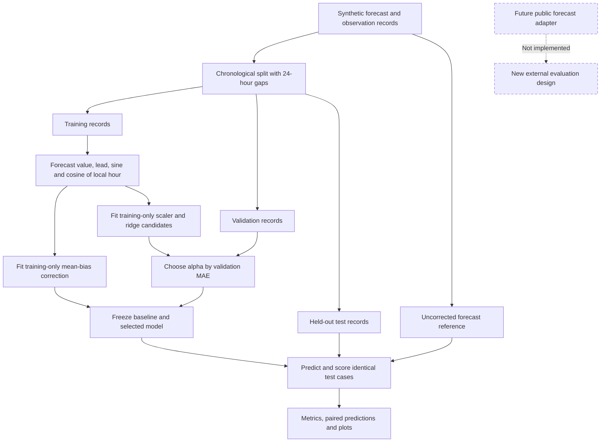

# Synthetic demonstration: methodology and validation

This page covers the synthetic exercise only. The separate [public archived-forecast evaluation](REAL_WORLD_EVALUATION.md) uses actual NOAA station observations and has its own frozen splits, sources, uncertainty analysis and limitations.

## Evidence boundary

The synthetic implementation is an independent exercise. It does not reuse research source files, weights, station settings, measured data, or internal artifacts. Both the numerical-forecast-like input and the observation-like target in this exercise are fictional. The separate public-data workflow must not be confused with these synthetic inputs or scores.

The held-out test described below has been executed for this synthetic example. It is separate from historical company-context development diagnostics. Real-data transfer and external validation remain future work.

## Data-generating assumptions

`src/synthetic_data.py` creates 2,160 hourly records with seed 83021. A daily cycle, slowly changing component, correlated weather-like disturbance, and independent observation noise create fictional temperature and humidity. A separate forecast-like signal adds systematic time-of-day and lead-dependent bias plus forecast noise.

The generator has access to a latent fictional process because it constructs the exercise. The learner receives only the resulting forecast value, local hour, and lead time as features. It cannot read the generator's latent process or observation label through feature preparation.

This is deliberately a learnable correction problem. It omits storms, real geography, provider errors, calibration drift, seasonal distribution changes, and real packet-arrival delays. Good scores are evidence that this implementation recovers this constructed relationship—not evidence of operational weather skill.

Times are relative integer hours. No station identity, physical location, real measurement, or proprietary threshold is encoded. Forecast leads cycle through 1, 6, 12, and 24 hours; this is an illustrative fixture, not a representation of a forecast provider's issuance schedule.

## Implemented architecture

All solid paths below are implemented for the synthetic exercise. The dashed extension is future work and does not feed the posted results.

## Split and availability contract

The nominal boundaries are at 60% and 80% of generated records. The 24 records immediately after each boundary are excluded, leaving:

| Partition | Cases | First valid hour | Last valid hour |
| --- | ---: | ---: | ---: |
| Training | 1,296 | 24 | 1,319 |
| Validation | 408 | 1,344 | 1,751 |
| Test | 408 | 1,776 | 2,183 |

For every record, issue hour equals valid hour minus lead. `split()` asserts that the latest observation label in an earlier partition precedes the earliest issue time in the next partition. This prevents a selected model from using labels that would become available only after a later prediction's issue time.

This contract assumes synthetic observations become available at their valid hour. It is not evidence about any real sensor's arrival delay. A live system would need separate measurement and receipt timestamps and a defined model-freeze time.

No observation-history feature is used in this first example. Extending it would require availability-aware joins and additional leakage tests.

## Features and correction models

Each target is modeled independently. The four features are the target's forecast value, forecast lead, sine of local hour, and cosine of local hour. Scaling means and standard deviations are fitted on training rows only. No observed target is part of the input feature vector.

Three predictions are compared:

1. **Raw reference:** the uncorrected synthetic forecast.
2. **Mean-bias correction:** add the mean training residual, where residual = observation minus forecast.
3. **Ridge correction:** regress the training residual on standardized features and an intercept. Add the predicted residual to the original forecast.

The ridge learner is implemented independently in `src/model.py`; it does not load a pretrained library model. It solves a small regularized normal-equation system with partial-pivot Gaussian elimination. The intercept is unpenalized. This implementation suits the small fixture; it is not intended as a general numerical linear-algebra library.

The regularization candidates are 0.1, 1.0, and 10.0. Selection minimizes validation MAE separately for temperature and humidity, with ties resolved by the lower alpha. The selected model is not refitted on validation rows. The test set does not participate in fitting, scaling, or alpha selection.

All humidity outputs are limited to 0–100%. This bound applies to all three methods. Temperature is not clipped. Learned coefficients in `results/models.json` come solely from this generator and are regenerated by the verification command.

## Metrics and plots

For matched observations y and predictions p:

- MAE = mean(abs(p − y)).
- RMSE = sqrt(mean((p − y)²)).
- Signed bias = mean(p − y); positive means overprediction.

Temperature errors use degrees Celsius. Humidity errors use percentage points. Metrics require nonempty, equal-length pairs. All three methods use the same 408 test cases for each target. Full MAE, RMSE, signed bias, and sample counts are saved in `results/metrics.json`.

The forecast-versus-observation graph uses the first 96 test hours, a fixed display window rather than an error-selected interval. The error bars chart reports MAE over all 408 test hours. Colors are consistent across both figures. These are ordinary score bars, not confidence intervals.

The exercise reports no overall accuracy percentage, rain score, confidence interval, cross-site transfer result, or company-system comparison. It does not prove that ridge outperforms more complex models or remains superior under distribution shift.

## Reproduce and verify

Run `python examples/run_demo.py --verify` from the repository root. The command generates a new fictional dataset in a temporary directory, retrains the models, recomputes scores and paired predictions, and compares them with the committed numerical artifacts. It also checks the committed numerical files against their SHA-256 checksums.

Verification does not trust or load the posted weights to generate new predictions. Floating-point values are compared with relative and absolute tolerances of 1e-10. Repeated numerical runs in the same environment are additionally tested for byte-for-byte equality. Graph files are excluded from numerical checksum verification because rendering can vary by platform and library version.

`python examples/run_demo.py` regenerates numerical outputs and both PNGs. Plotting dependencies are pinned in `requirements.txt`; numerical training and verification use only the Python standard library. The `--seed` and `--output` options support separate experiments. To verify a custom seed, supply the same seed and output directory used to generate its reference artifacts.

The tests check partition availability, invariance to changed held-out labels, feature independence from observation labels, training scaling, recovery of a known constant residual, metric pairing, numerical repeatability, and detection of changed artifacts or scores.

## Future external evaluation

A public weather adapter and any real-observation benchmark would be a new experiment. Before making real-world claims, specify provider provenance and permissions, archive issue-specific forecasts, audit receipt times, fit on earlier periods, reserve genuinely unseen conditions, and report missing cases and coverage.

Replacing synthetic forecasts with public forecasts while retaining synthetic targets would still be a synthetic-target experiment. It would not establish real station forecast accuracy. Rainfall modeling would need a separate event definition, matched accumulation windows, occurrence and amount evaluation, and comparison against dry-dominated baselines.
